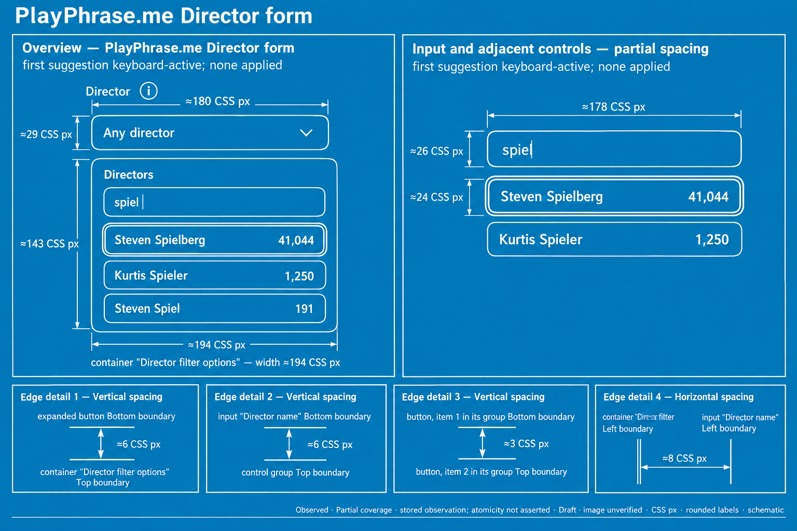
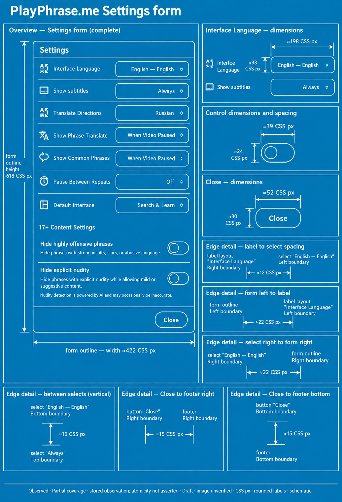
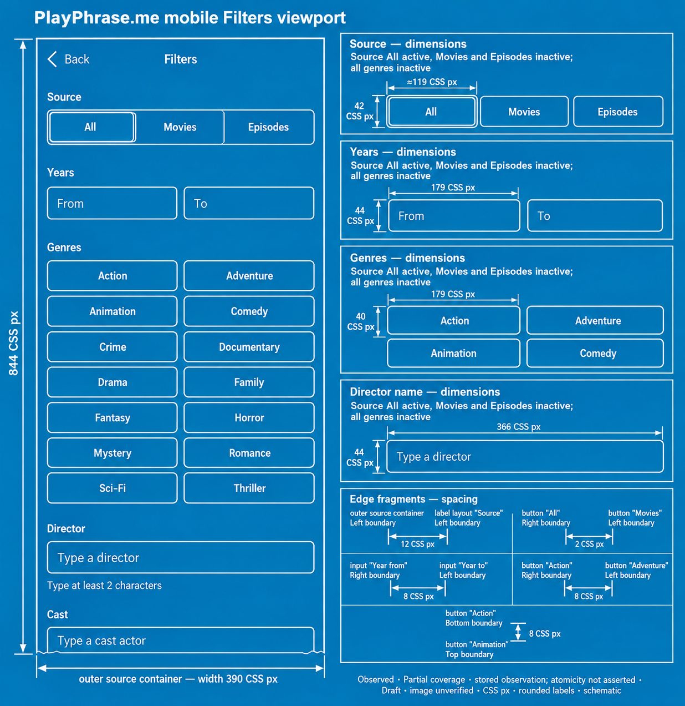

# UI Blueprint

**Geometry for agents. Blueprints for people.**

UI Blueprint gives AI agents a measurable view of an interface. Its local Rust
engine works with UI structure and geometry to measure spacing, check alignment,
and compare states. The same observations become ImageGen prompts for annotated
blueprints that help people understand the interface and discuss changes.



*An observed PlayPhrase.me Director picker: the open popup, search results,
keyboard-active state, and measured spacing on one sheet.*

## Give an agent geometry it can reason about

UI work needs both appearance and measurements. A screenshot shows how a screen
looks; runtime data supplies element bounds, reported relationships, and available
states. UI Blueprint brings that structure into the agent's workflow through
compact output and JSON.

The agent selects a component or surface, obtains an observation, and asks the
Rust engine for the measurements it needs. Geometry calculations and checks run
locally without a model call. The agent can spend its reasoning on what to change,
with numerical results available to support the decision.

### Understand an unfamiliar interface

Inspect a form, popup, or panel before editing it. Find the reported controls and
their states, inspect component parts where the source exposes them, and measure
the relationships between their edges. Alongside a screenshot, this gives the
agent evidence for questions such as whether a popup fits its container or two
controls share an alignment axis.

### Find patterns in spacing and size

Compare widths, heights, gaps, proportions, and containment. For an explicitly
selected family of controls, optional design analysis can identify a repeated
measurement and show deviations from it. Checks can evaluate a supplied
requirement with an explicit tolerance. Observed regularity stays separate from
the design requirement: a common gap is useful evidence, not an automatic rule.

### Show what changed

Keep observations from before and after an edit. Compare compatible records to
see changes in geometry, properties, structure, and focus, then prepare a
comparison document for review. A moved edge or changed width gives an agent
something concrete to explain alongside the visible result.

Comparison preserves each source's scope and identity. Records that need an
explicit correspondence use the [declared-pair workflow](docs/development/diff.md#external-observations-with-declared-correspondence).

### Discuss the interface with a person

Use an overview to explain the layout, then enlarge a control or spacing detail
that needs attention. The result gives a developer, designer, or client a shared
reference for a review. A proposed layout can also become a blueprint when its
requirements and target dimensions are supplied explicitly; the document keeps
that proposal distinct from a runtime observation.

## Turn measurements into an ImageGen brief

Prompt preparation is part of the tool. The `imagegen-prompt` command compiles
selected observations into a drawing package with the information needed to
depict the interface: objects, states, dimensions, measurement anchors, scope,
and drawing instructions.

The workflow has four steps:

1. **Observe** a selected Web or macOS surface through its platform collector.
2. **Analyze** the saved data with the Rust engine.
3. **Compile** a drawing brief, exact scene and dimension data, a sheet plan,
   and a self-contained ImageGen prompt.
4. **Render and review** the image separately, using the exported prompt and a
   reviewed source screenshot where the drawing plan calls for one.

The package contains `drawing-brief.md`, `scene.json`, `dimensions.json`,
`sheets.json`, `manifest.json`, and `prompt.txt`. Split single-view packages also
include a standalone prompt for each sheet. The drawing can use rounded labels
while the machine files retain the original measurements and their provenance.

**The CLI prepares the prompt locally; it does not call ImageGen or require an
API key.** Image generation is a separate step. Its output is schematic and must
be checked against the source data before being used as an engineering reference.

[See the export workflow and examples →](docs/development/export.md)

## Explore real interface blueprints

These examples use saved Web observations from PlayPhrase.me. Settings shows a
complete form with control and spacing details. The mobile Filters example shows
a responsive Web viewport, including where its visible content ends.

<table>
  <tr>
    <th>Settings: a form and its spacing</th>
    <th>Mobile Web: layout within a viewport</th>
  </tr>
  <tr>
    <td valign="top"><a href="docs/readme-settings.png"></a></td>
    <td valign="top"><a href="docs/readme-mobile-filters.png"></a></td>
  </tr>
</table>

Open an image to read it at full size. These illustrations passed
[content](docs/plans/ui-blueprint/receipts/human-blueprint-content-review.md#fresh01-c6--final-hbp-c-acceptance-of-all-six-fresh-outputs)
and [visual](docs/plans/ui-blueprint/receipts/human-blueprint-visual-review.md#fresh01-c6--final-six-cell-visual-acceptance-2026-10-11)
review at their original sizes. Their footers preserve the status recorded before
that review. This verification covers the pictured forms; generated drawings
still need review and are not pixel-exact exports.

## Try it locally

The documented build requires Python 3.11+, Git, the pinned Rust toolchain and
cached dependencies. See [build prerequisites](docs/development/distribution.md#prerequisites-and-selection)
before running these commands from the checkout.

Build and verify the documented Web bundle in a temporary directory:

```sh
BUNDLE="$(mktemp -d "${TMPDIR:-/tmp}/uib-local.XXXXXX")"
python3 distribution.py build --modules web --revision ea06095bf311e7e33af90e8d72fe822690a3223e --destination "$BUNDLE"
python3 "$BUNDLE/distribution.py" verify --destination "$BUNDLE"
"$BUNDLE/uiblueprint" --help
```

For a first observation, supply an already authorized browser DevTools WebSocket,
the exact URL of an open page, and a supported selector for one component:

```sh
node "$BUNDLE/web-geometry.cjs" \
  --connection "$CDP_BROWSER_WS" \
  --url "$PAGE_URL" \
  --component "$COMPONENT_SELECTOR"
```

This optional caller requires Node.js 24+ and prepares the runtime identities and
request JSON. The [Web first-use guide](docs/development/web-first-use.md) explains
the connection, selection rules, and how to save the original observation for
analysis or export. The command uses the existing browser session without
launching or navigating it.

For saved-data examples, macOS collection, or another module selection, start with
the [distribution guide](docs/development/distribution.md) and
[CLI reference](docs/development/cli.md).

## Current scope

UI Blueprint is under active development. Local builds are available through the
documented bundle recipe; a release has not been published yet.

| Area | Available path |
| --- | --- |
| Local analysis | Inspect saved observations, measure geometry, check expectations, and compare records |
| Web | Collect from an explicitly selected surface in an authorized browser session |
| macOS | Collect available Accessibility data through the native helper; coverage depends on the app and permissions |
| Documents | Prepare observed, proposed, detail, comparison, and flow drawing packages from the required inputs |

The tested host is Apple Silicon macOS 27.0.1. Native builds additionally need
Swift/Xcode. Linux, Windows, Intel Macs, and older macOS runtimes are unqualified;
native iOS, Android, and TV adapters are not shipped. The mobile illustration above
comes from Web data.

Measurements retain their coordinate space, units, source, and availability.
Accessibility bounds are distinct from layout and painted bounds. Missing data
stays unknown, and a geometry check alone cannot establish that an interaction
succeeded. See the [Native acceptance record](docs/plans/ui-blueprint/receipts/Q01-integrated-acceptance.md#current-native-final-reconciliation--bounded-acceptance-2026-10-10)
for its verified scope and remaining availability limits.

Further reading: [geometry](docs/development/geometry.md),
[comparisons](docs/development/diff.md),
[product specifications](docs/specs/README.md), and
[dependency notices](THIRD_PARTY_NOTICES.md).
